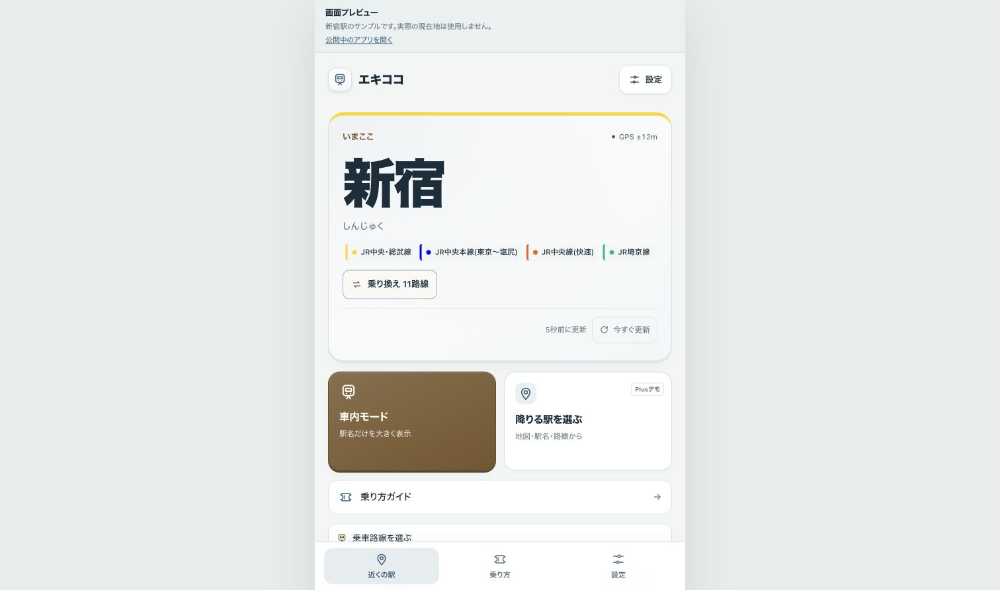
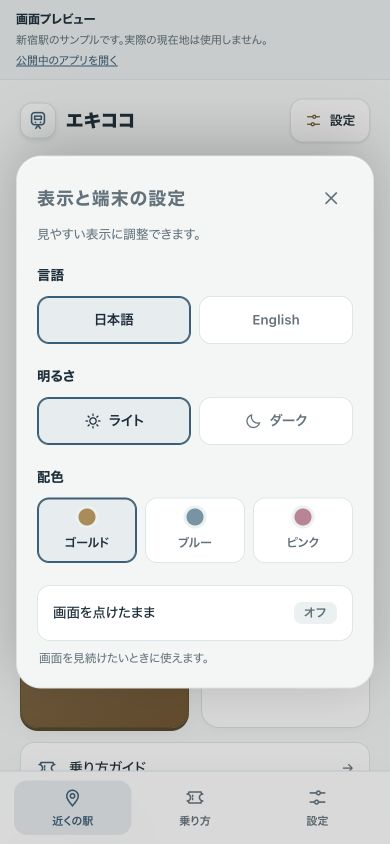

# 採用したアプリの操作改善

対象: `index.html` / `app.js` / `app-ux.css`。
オーナーが2026年11月7日に、実装プレビューの操作と設定画面を確認し、このデザインで公開する方針を選択した。

確認したプレビュー: https://9e45362f.ekikoko.pages.dev/app-preview

## 採用した点

- 開始前に日本語／Englishを選べ、位置情報なしで乗り方ガイドを開ける。
- 現在駅の下に車内モード・降車駅選択を並べる。主な用途を短い説明で示す。
- 近くの駅・乗り方・設定への固定ナビゲーションを置く。
- 設定は言語・明暗・配色を並べ、選択中の状態を明示する。
- 既存の駅名標の厚み・影と、ガイドの動く図解を維持する。
- 広告未設定の空の枠は表示しない。

## 画面

画像は新宿の固定サンプルを表示した実装プレビュー。画面上部の試作説明は本番には出さない。色・サイズ・配置はHTML/CSSの実装を採用し、画像をUIとして貼り付けない。

## 確認と範囲

位置更新・乗車路線の既存テスト18件、JS構文、通常ビルド37ファイル・試作39ファイル、ローカルアセット参照を確認。Chromeの320px・390px・PC幅で横はみ出しがなく、ガイド・車内モード・路線選択・設定・ダイアログ終了後のフォーカス復帰を確認した。

本番の位置取得・駅判定の仕組みは維持。サンプル用HTMLと派生ランタイムは対象の確認用ブランチだけで生成し、本番には含めない。キャッシュはv65。実際の乗車、電池消費、地下からの復帰の実地確認は別途継続する。追加費用・有料サービスなし。
